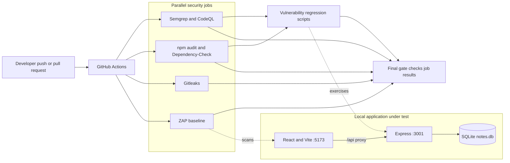

# Faultline Lab

A hands-on DevSecOps testbed: a deliberately vulnerable notes application plus a GitHub Actions pipeline for finding its flaws. The app is a teaching target, **not** a secure note-taking service. Run it on localhost with disposable data only.

## At a glance

| Layer | Implementation | What it demonstrates |
| --- | --- | --- |
| UI | React 17, Vite | Note creation, browsing, search and raw-HTML rendering |
| API | Express 4, better-sqlite3 | CRUD and an injectable search endpoint |
| Security pipeline | Semgrep, CodeQL, npm audit, Dependency-Check, Gitleaks, OWASP ZAP | Static, dependency, secret and runtime checks |
| Exercises | `tests/vulnerability/` | XSS, SQLi, IDOR and dependency regression scripts |

## Architecture



The regression job waits for SAST and SCA; DAST and Gitleaks run independently. The final gate fails if any required job fails, is cancelled or is skipped. This repository intentionally contains findings, so a failing security job can be the expected observation—not proof of a broken CI runner. A successful job is **not** a clean security bill: CodeQL uploads findings without failing the analysis job solely because alerts exist, and the current Semgrep command does not enable findings-as-errors.

## Vulnerabilities by design

| Surface | Location | Exercise |
| --- | --- | --- |
| XSS | `frontend/src/components/NoteCard.jsx` | Raw note HTML is rendered with `dangerouslySetInnerHTML`. |
| SQL injection | `backend/routes/notes.js` (`GET /api/notes/search`) | The query string is concatenated into SQL. |
| Missing authorization / IDOR | `backend/routes/notes.js` | Note endpoints require no login or ownership check. |
| Weak browser policy | `backend/server.js` | Helmet CSP and XSS filter are disabled. |
| Seeded secret specimens | `backend/seeded-secret.env` | Synthetic values for secret-scan exercises; do not replace with live credentials. |
| Dependency findings | `frontend/` and `backend/` lockfiles | SCA tools audit the actual resolved dependency trees. |

**Do not deploy this app on a public network.** Do not enter real secrets, use real accounts, or test against a service you do not own. The landing page's scanner cards describe CI configuration, not live results.

## Run locally

Prerequisites: Node.js 18+ (20 or 22 recommended) and npm. `better-sqlite3` is a native add-on; newer Node versions may require a C/C++ build toolchain if no prebuilt binary exists. Two terminals, from the repository root:

```bash
cd backend && npm ci && npm start
```

```bash
cd frontend && npm ci && npm run dev
```

Open `http://localhost:5173`. Vite proxies `/api` to `http://localhost:3001`; the API health endpoint is `http://localhost:3001/api/health`. The backend creates `backend/notes.db` on first launch and seeds example notes only when the table is empty. The database persists between launches; keep test data disposable.

To verify the UI build and the non-destructive unit tests:

```bash
cd frontend && node --test src/notesView.test.js && npm run build
node --test ../tests/workflow/gate.test.js
```

The commands above assume the current directory is `frontend` for both lines. The `tests/vulnerability/` scripts are **not** safe read-only smoke tests: some create and delete notes, and the IDOR script updates note ID 1. Run those only against a disposable database after reviewing them.

## CI and scanner behaviour

`.github/workflows/ci-pipeline.yml` runs on pushes to `main`/`develop` and pull requests targeting `main`. Semgrep and CodeQL cover static analysis; npm audit and OWASP Dependency-Check inspect dependencies; Gitleaks scans history; ZAP baseline tests the running Vite app; then vulnerability scripts run after SAST/SCA. Check each job's log and uploaded artifacts for findings. The final gate checks actual job results instead of printing unconditional success.

`.github/workflows/nightly-dast.yml` is currently **commented out** and does not schedule a scan. Local helpers in `scripts/` are demonstrations, **not equivalent to CI gates**: several suppress scanner exit codes and may report completion despite findings. For meaningful pass/fail status, inspect the scanner output or run the underlying tool directly. ZAP's helper requires Docker; CodeQL, Semgrep and Dependency-Check require their own CLIs. The UI and unit tests do not need those tools.

## Repository map

- `frontend/` — app UI, Vite config and notes view tests.
- `backend/` — Express routes, SQLite setup and synthetic secret specimens.
- `.github/workflows/` — CI pipeline and disabled nightly DAST example.
- `.semgrep/`, `.zap/`, `.gitleaks/`, `.dependency-check/` — scanner rules and suppressions.
- `tests/vulnerability/` — invasive security exercise scripts; `tests/workflow/` — CI gate assertion.
- `docs/deepdive.md`, `docs/security-comparison.md` — deeper design and testing notes.
- `scripts/` — local scanner and service helpers; review side effects before use.

This is an educational lab. Fixing an intentional vulnerability changes the exercise and may alter expected scan results; ordinary UI and pipeline correctness bugs are separate from that teaching surface.
